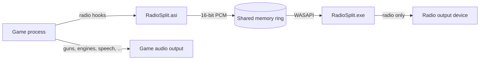

# RadioSplit

> GTA III, Vice City, and San Andreas radio in its own audio process.

**[Download the latest release](https://github.com/JDuesterhus/gta_radio_split/releases/latest)** · **[Report a problem](https://github.com/JDuesterhus/gta_radio_split/issues)**

RadioSplit takes **only the car radio** out of the game's audio and plays it from a small separate program, `RadioSplit.exe`. The game keeps its guns, engines, footsteps, speech, cutscenes, ambience, and police scanner. Windows and OBS see the radio as its own audio source, so you can hear it while keeping it out of a stream or recording.

## What it does

- **Only the radio is split.** Everything else stays in the game's normal mix.
- **Works with the classic 32-bit PC versions** of GTA III, Vice City, and San Andreas. Most known versions are covered; if yours isn't, please report it.
- **The radio in the main menu works too**, and the game's radio/music volume slider still controls the radio volume.
- **Talk radio can stay in the game** — on by default. WCTR, Chatterbox FM, K-Chat, and VCPR.
- **Custom radio can stay in the game** — San Andreas User Tracks and the III/VC MP3 player.
- **Useful for clean Twitch VODs and YouTube recordings.** Keep the radio out of what you send to the platform, but still hear it yourself. The OBS side is shown in [this video](https://www.youtube.com/watch?v=kAKzH7jpM_U); this README covers the game side.

> RadioSplit controls what is in your audio mix. It is not legal advice, and platform copyright rules still apply.

## Supported games

| Game | Known working versions |
|---|---|
| **GTA III** | 1.0, 1.1, Steam |
| **GTA Vice City** | 1.0, 1.1, Steam |
| **GTA San Andreas** | 1.0 US (compact and hoodlum), 1.01, 2.0, 3.0, Steam `gta-sa.exe` |

The plugin scans the running game for the radio code instead of relying on one fixed address, so other re-releases and modded executables often work too. Packed executables are scanned after they unpack.

**Does your version not work?** Please [open an issue](https://github.com/JDuesterhus/gta_radio_split/issues) with the game name, the executable name/version, and `RadioSplit.log`. Do not upload game files.

This is for the **classic 32-bit PC versions**. The Definitive Edition is a different engine and is not supported.

## Why would I use it?

Twitch VODs and YouTube uploads can be muted or claimed because of licensed music. RadioSplit lets you keep the licensed radio out of the audio you send to the platform while still hearing it in your headphones. The game audio and the radio become two separate sources, so you can route the radio to yourself only.

The mod handles the game side. For the OBS side — capturing the radio separately and keeping it out of the stream — follow **[this video](https://www.youtube.com/watch?v=kAKzH7jpM_U)**.

## Install

1. **Download** the latest release and extract it.
2. Install **Ultimate ASI Loader** in the game folder if you don't already have it:  
   [Ultimate ASI Loader](https://github.com/ThirteenAG/Ultimate-ASI-Loader)
3. Copy these three files into the game folder — the folder with `gta3.exe`, `gta-vc.exe`, or `gta_sa.exe`:
   - `RadioSplit.asi`
   - `RadioSplit.exe`
   - `RadioSplit.ini`
4. Start the game. `RadioSplit.log` appears next to the ASI and lists the playback devices it found.
5. Optional: set `OutputDevice` in `RadioSplit.ini` if you want the radio on a specific output. Leave it empty for the Windows default.
6. On the OBS side, follow the video above.

`RadioSplit.exe` must keep its name and sit next to the game executable. The ASI can also live in `scripts`; the `.ini` and `.log` stay next to the ASI. The helper starts with the game and exits with it — you don't launch it yourself.

The release zip contains `RadioSplit.asi`, `RadioSplit.exe`, `RadioSplit.ini`, and this README.

### Uninstall

Delete `RadioSplit.asi`, `RadioSplit.exe`, `RadioSplit.ini`, and `RadioSplit.log`. The stock game mix returns.

## Use

- Start the game and turn on a radio station. The station now comes from `RadioSplit.exe`; the game's own radio is muted by default.
- The Windows volume mixer shows `RadioSplit.exe` separately. Use that slider to control the radio volume.
- The in-game/menu radio volume slider also works.
- Radio off or on foot: the radio source goes silent.
- Pause the game: the radio stops. III and Vice City had already queued the next Miles buffer; that audio is dropped.
- The radio can be slightly behind the engine sound. Retune static can remain in the game mix.
- If the mod cannot decode a station or the player fails, the game radio stays audible as a fallback. `RadioSplit.log` says why.

## Configuration

`RadioSplit.ini` lives next to the ASI. Defaults:

| Setting | Default | What it does |
|---|---|---|
| `Enable` | `1` | `0` disables the mod without deleting files. |
| `MuteInGame` | `1` | `1`: the game's radio is muted and `RadioSplit.exe` plays it (no double audio). `0`: the radio also stays in the game. |
| `OutputDevice` | empty | Playback device for the radio. Empty = Windows default. Use a unique part of a name from `RadioSplit.log`. |
| `TalkRadio` | `1` | `1`: talk stations stay in the game. `0`: they go to `RadioSplit.exe` like music stations. |
| `CustomRadio` | `0` | `1`: User Tracks (SA) / MP3 player (III, VC) stays in the game. `0`: it goes to `RadioSplit.exe`. |

- Talk stations: WCTR, Chatterbox FM, K-Chat, VCPR.
- Custom station: User Tracks in San Andreas; the MP3 player in III and Vice City.
- Older ini files can still use `UserTracksInGame` and `WctrInGame`. If both old and new names are present, the later line wins.

## Troubleshooting

Start with `RadioSplit.log` next to the ASI.

| Log line | Meaning |
|---|---|
| `Started ... (outside the game process tree)` | The helper is running and isolated from the game's process tree. Good. |
| `Started ... (as a child of the game)` | The helper started, but Windows would not let it use Explorer as its parent. It still plays; capturing the game with OBS may also include the radio. |
| `RadioSplit.exe failed: ...` | The helper could not open the playback device. Clear `OutputDevice` or fix the name. |
| `San Andreas radio code was not found.` | The exe version/address pattern is not recognized. Report it with the log. |
| `Miles radio tap installed` | The III/VC hooks attached. |
| `Miles stats: ...` | Written every two seconds: stream opens, matched radio loads, and copied PCM bytes. |

Other common fixes:

- **The radio still comes from the game:** check `Enable=1` and `MuteInGame=1`. If the ASI was not loaded, there is no log or no `RadioSplit.exe`.
- **Talk or custom radio is still in the game:** that is intentional with `TalkRadio=1` / `CustomRadio=1`. Set them to `0` to send those stations to the helper.
- **No radio sound at all:** clear `OutputDevice` to use the Windows default, then check the log for the opened device name.
- **OBS does not list `RadioSplit.exe`:** make sure the game is running, the new `RadioSplit.exe` is in the game folder, and you reopen the OBS source properties. OBS 28+ on Windows 10 2004+ or Windows 11 is required.
- **A version is not recognized:** report the game, exe version, and log. Please don't attach game files.

## How it works

RadioSplit is a 32-bit ASI plugin plus a small 32-bit player.



The key point is that the radio is **rendered by a different process**. Windows and OBS identify audio by process; a stream opened inside `gta_sa.exe` would always be part of the game's audio. `RadioSplit.exe` has its own PID, so it appears as its own source.

### San Andreas

San Andreas plays the radio through a DirectSound streaming buffer. The ASI:

- finds `CAEAudioHardware`, `CAERadioTrackManager`, and the vehicle-radio check by scanning the running executable;
- detours the radio buffer's `SetVolume` and `Unlock`;
- reads the PCM that is actually audible from the buffer's play cursor;
- mutes only that buffer when the helper is alive;
- writes the station to the shared ring.

The scan means packed or relocated executables can work; `RadioSplit.log` prints the addresses it found.

### GTA III and Vice City

III and Vice City use Miles (`mss32.dll`). The ASI:

- hooks `AIL_open_stream`, `AIL_close_stream`, `AIL_load_sample_buffer`, `AIL_set_stream_volume`, and `AIL_pause_stream`;
- classifies the opened file as a music, talk, or custom station;
- decodes III's IMA ADPCM WAVs and Vice City's MP3/ADF stations (ADF is MP3 with each byte XOR `0x22`) to 16-bit stereo;
- writes the decoded PCM to the same shared ring;
- silences the game's copy only after decoded audio is flowing.

The game still has to play its compressed buffer, or Miles would stall; the plugin keeps that buffer intact and only silences the volume.

### The shared ring and the player

- One shared-memory ring per game process: `Local\RadioSplitAudio-<pid>`.
- 1 MiB ring of 16-bit PCM, with sample rate, channel count, gain, heartbeat, and game PID.
- `RadioSplit.exe` maps the ring, opens the chosen playback device with WASAPI (miniaudio), buffers about 120 ms, applies the game's radio volume, and exits when the game does.
- The player is started with Explorer as its parent, so OBS's process-tree capture of the game does not include the radio.
- The player keeps a 1×1, off-screen, transparent top-level window. OBS's Application Audio Capture finds a process through a window; the window is invisible and has no taskbar button.

### Repository layout

| Path | Contents |
|---|---|
| `src/loader` | ASI entry point |
| `src/games/sa` | San Andreas DirectSound hook |
| `src/games/miles` | GTA III / Vice City Miles hook |
| `src/split` | mute/capture gating and tests |
| `src/output` | shared memory, volume, WASAPI helpers |
| `src/player` | `RadioSplit.exe` |
| `tests` | gate tests |
| `third_party/miniaudio` | audio device and MP3 decoding |

## Build from source

Requirements: Windows and Visual Studio Build Tools with the **x86 C++** workload.

```bat
build.bat
```

`build.bat` finds the newest Visual Studio installation, or uses `VCVARS` if you set it to a `vcvarsall.bat`. It builds and runs the gate tests, then produces:

- `RadioSplit.asi`
- `RadioSplit.exe`

The binaries are statically linked; no Visual C++ redistributable is needed.

### Releases

GitHub Actions builds main, pull requests, and tags. Pushing a tag such as `v1.0.0` builds the files and publishes a GitHub release with the `.asi`, `.exe`, `.ini`, and a zip:

```bash
git tag v1.0.0
git push origin v1.0.0
```

The workflow is in `.github/workflows/build.yml`.

## Credits

- [Ultimate ASI Loader](https://github.com/ThirteenAG/Ultimate-ASI-Loader) by ThirteenAG.
- [miniaudio](https://github.com/mackron/miniaudio) by David Reid, including dr_mp3.
- GTA III, Vice City, and San Andreas are property of Rockstar Games. This project includes no game files.

---

Not affiliated with Rockstar Games or Take-Two Interactive. Use at your own risk.
